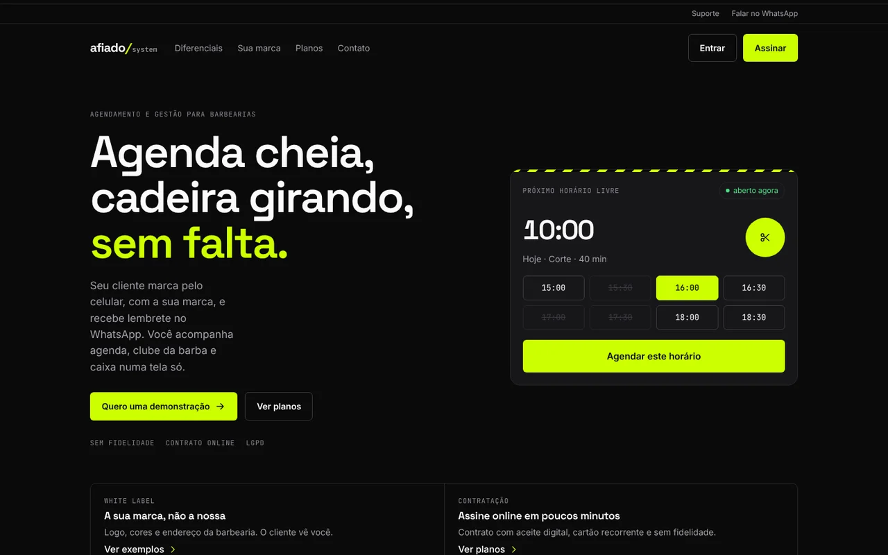
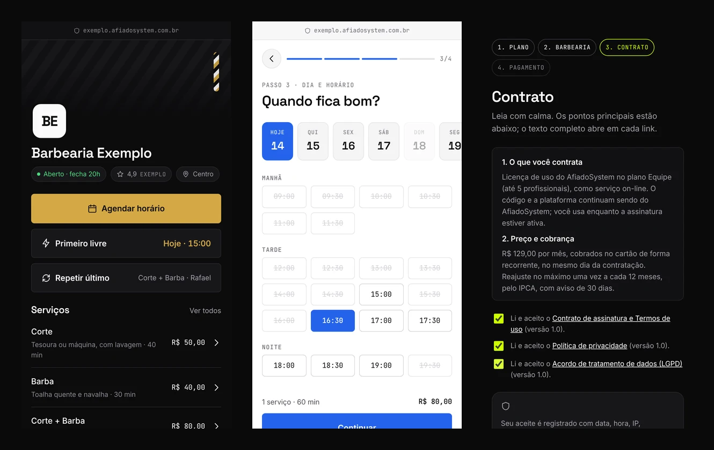
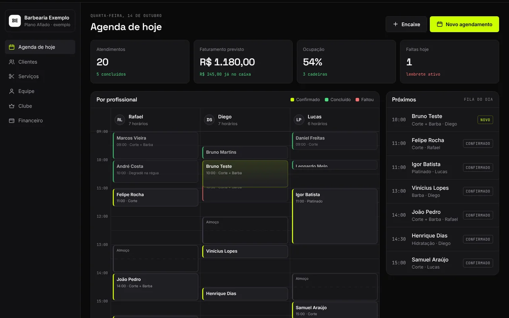
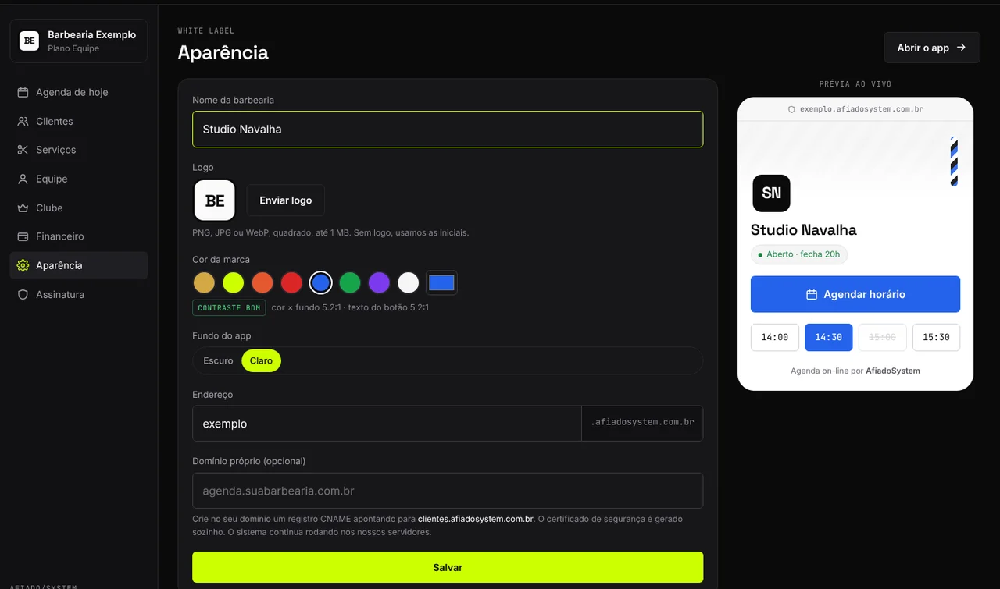
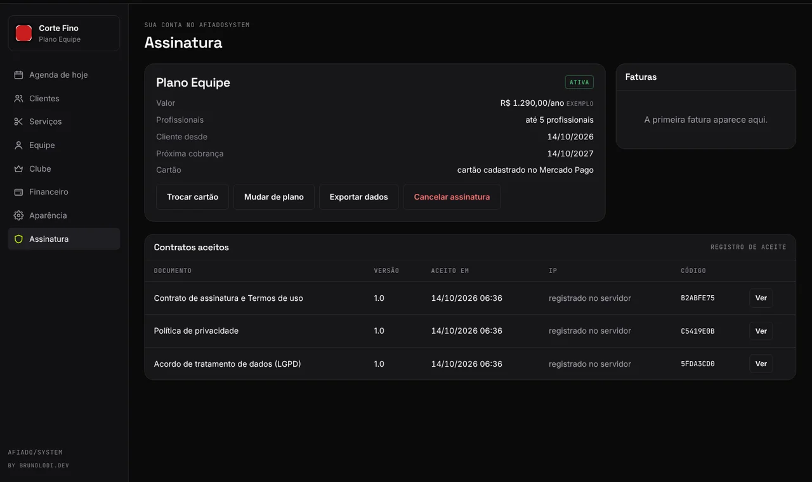

# AfiadoSystem

**Agendamento e gestão para barbearias, vendido como SaaS white label.**
by [brunolodi.dev](https://brunolodi.dev)

> Estudo de caso. O código é proprietário e fica em repositório privado.
> Aqui estão o problema, as decisões de produto e as telas.

## O problema
Os sistemas de barbearia mais usados no Brasil pedem login antes de mostrar qualquer coisa. O cliente quer saber
preço e horário livre, mas antes precisa preencher um cadastro com seis campos obrigatórios.

Do lado da barbearia, agenda, clube de assinatura, caixa e comissões ficam espalhados em planilhas e no WhatsApp.

## A proposta
Uma plataforma para **várias barbearias**, onde cada uma aparece com **a própria marca**:

- **App do cliente:** vê serviços, preços e horários **sem criar conta**. Confirma só com nome e WhatsApp
  (código de verificação, sem senha). Primeiro horário livre, repetir o último corte, reagendar com um toque, lista de espera.
- **Painel do dono:** agenda por profissional, fila do dia (chegou, concluído, faltou), clientes sumidos,
  clube da barba, comissões e caixa.
- **White label:** logo, cor e fundo claro/escuro de cada barbearia, com prévia ao vivo e verificação de
  contraste. Endereço `barbearia.afiadosystem.com.br` ou domínio próprio.
- **Contratação 100% on-line:** plano → dados da barbearia → contrato com aceite registrado → cartão recorrente.

## Decisões de produto
| Decisão | Por quê |
|---|---|
| Agendar antes de pedir cadastro | O cliente decide pelo horário e pelo preço; a conta é um detalhe no fim |
| WhatsApp pela API oficial | Lembrete confiável, sem risco de bloqueio do número |
| Site de vendas que mostra pouco | Diferenciais à vista, painel completo só na demonstração; protege o produto da concorrência |
| Sem fidelidade | Diminui a barreira de entrada para barbearias pequenas |
| Dinheiro do clube vai direto para a barbearia | Cada barbearia conecta a própria conta de pagamento; a plataforma não intermedeia |
| LGPD desde o início | A barbearia é controladora dos dados; a plataforma é operadora, com acordo de tratamento no contrato |

## Contrato e aceite on-line
O aceite registra documento, versão, hash do texto exato, data e hora, IP e navegador, e o cliente recebe
uma cópia por e-mail. O contrato prevê direito de arrependimento de 7 dias, cancelamento sem multa pelo painel
e regras claras de atraso e de exclusão de dados.

## Tecnologia
Node.js + Hono · PostgreSQL · aplicativo web instalável (PWA) · Mercado Pago (assinatura recorrente)
· WhatsApp Cloud API · Coolify em VPS · subdomínio por barbearia e domínio próprio com certificado automático.

## Identidade visual
Fundo quase preto, lima `#CCFF00` e branco, a mesma identidade do brunolodi.dev.
Títulos em Space Grotesk, texto em Inter e rótulos em JetBrains Mono.

## Status
Protótipo navegável concluído. Sistema em desenvolvimento.

---
© Bruno Lodi · [brunolodi.dev](https://brunolodi.dev) · Todos os direitos reservados.
As imagens usam dados fictícios.
